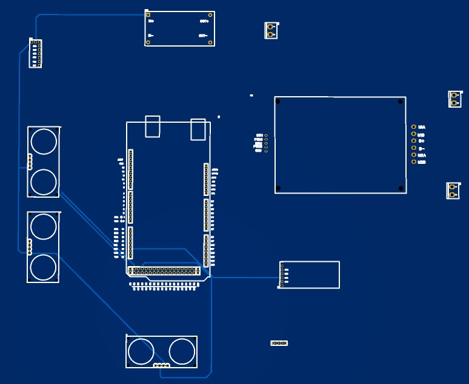

# Minesweeper Robot

A four-wheel, radio-controlled metal-detection prototype using an Arduino Mega 2560, an inductive detector, and three ultrasonic sensors. It reports changes in the detector signal through an LCD, LED, buzzer, and Bluetooth telemetry. A metal-detection event does not identify an explosive.

## How it works

- RC throttle and steering commands control the left and right motor groups.
- The detector connects to analog input A0. The sketch averages 100 readings at startup to set a baseline.
- A change of at least `DET_DELTA` from the baseline triggers the alarm. The current value is 80 ADC counts and needs calibration.
- Front, left, and right ultrasonic distances are reported over Bluetooth; they do not automatically stop or steer the robot.
- Missing or out-of-range RC pulses stop the drive outputs. A receiver that holds its last valid command may not trigger this response.

## Repository materials

| Material | Location |
| --- | --- |
| Arduino Mega control sketch | [MinesweeperMega.ino](firmware/MinesweeperMega.ino) |
| Parts list | [Bill of materials](hardware/BOM.md) |
| Circuit schematic | [Schematic image](hardware/Sch-MS.jpg) |
| PCB layout | [PCB image](hardware/PCB-MS.jpg) |
| Board preview | [3D board view](hardware/3D-MS.jpg) |
| System overview | [Block diagram](hardware/system-block-diagram.svg) |
| Controller layout concept | [PCB concept](hardware/pcb-concept.svg) |
| Detector setup and testing | [Calibration notes](docs/CALIBRATION.md) |

## Hardware preview

[View the schematic](hardware/Sch-MS.jpg) · [View the PCB layout](hardware/PCB-MS.jpg)

The images show the electronics layout. Check their connections against the sketch before wiring: the motor and ultrasonic pin assignments differ. The detector input and alarm connections are not detailed in the schematic image. Editable PCB files are not included, and PCB current capacity is unverified.

## Firmware connections

| Function | Pins or setting in the sketch |
| --- | --- |
| RC throttle / steering | 2 / 3 |
| Left motor PWM / direction | 5 / 22 |
| Right motor PWM / direction | 6 / 23 |
| Front ultrasonic trigger / echo | 30 / 31 |
| Left ultrasonic trigger / echo | 32 / 33 |
| Right ultrasonic trigger / echo | 34 / 35 |
| Detector input | A0 |
| LED / buzzer | 40 / 41 |
| LCD | I2C, address `0x27`, 16×2 characters |
| Bluetooth | `Serial1`, 9600 baud |

The sketch uses `Wire` and `LiquidCrystal_I2C`. Confirm the LCD address and library compatibility for your hardware.

## Bluetooth output

A Bluetooth serial terminal can display `ADC`, `metal`, `front_cm`, `left_cm`, and `right_cm`. A distance of `-1` means no echo was received within the timeout. The LCD shows detector status and the ADC reading.

See the [calibration notes](docs/CALIBRATION.md) before testing. Use ordinary metal targets in a controlled area and keep the physical power disconnect accessible.
